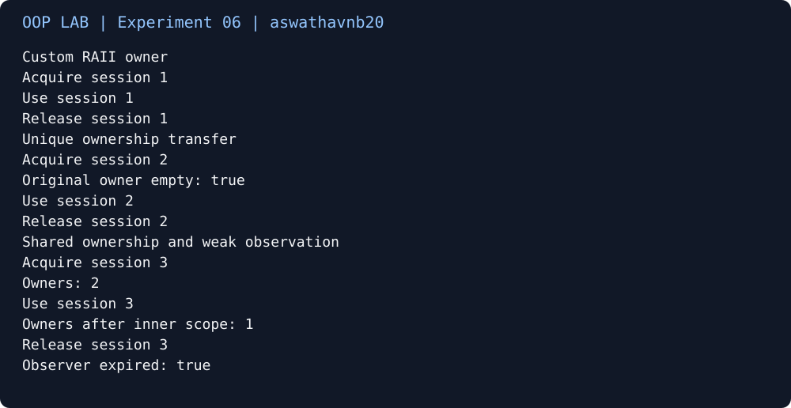

# Experiment 06

[Source code](Experiment6.cpp) · [Captured output](output.txt)

Output captured from a successful C++17 build and run. 

[Verified build](https://github.com/aswathavnb20/OOP-LAB/actions/runs/40887625756)
